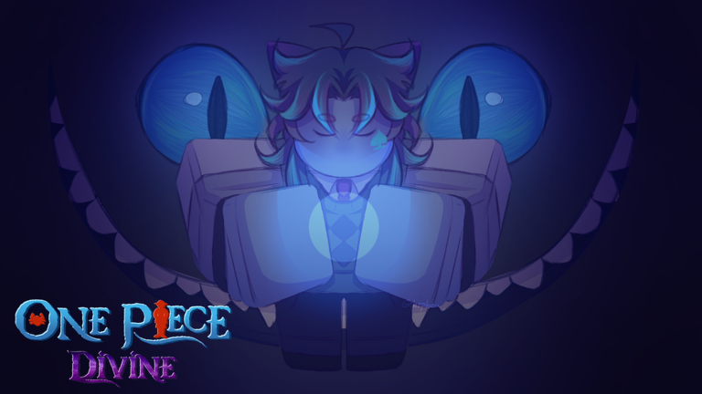
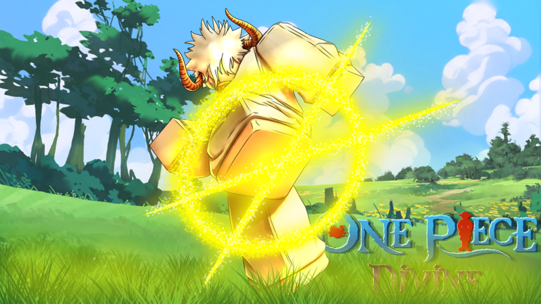

# One Piece: Divine - Revamp

Source code of the Revamp of **One Piece: Divine**, a live Roblox game with over 2.3 million visits. The whole game was rewritten from the legacy place into one typed, server-authoritative codebase, and every player's data was carried over.

**Play it:** https://www.roblox.com/games/112233665771826/One-Piece-Divine

| | |
|---|---|
| Language | Luau, `--!strict` in 1,283 of 1,308 files |
| Size | About 237,000 lines |
| Server | 81 services |
| Client | 35 controllers, 176 status effects, 148 one-shot effects |
| Content | 48 devil fruits with 206 modules for their moves, 10 boss modules |
| Version | Revamp 0.0.0b |

## Sneak peeks

Official thumbnails of the game.





## What is in this repository

Only the code. Models, animations, sounds, the map and the interface images live in the Roblox place and are not here, so the project does not run on its own. Webhook addresses are kept in a module of the place that is deliberately left out.

## Technical stack

- **Luau** with strict typing
- **Knit** for services and controllers
- **Fusion 0.3** for the interface
- **ProfileStore** for session-locked player data
- **Rojo 7.7** to sync the file system with Roblox Studio, pinned with **Aftman**
- **Wally** packages: Promise, Signal, Trove, Janitor, TableUtil, Iris and others, vendored under `Packages`

## Architecture

The server decides everything that matters. A client sends intentions and draws results.

```
key, pad button or touch
        |
InputController      one place where input becomes an action
        |
AbilityController    sends: fruit slot, ability slot, pressed or released, aim point
        |
AbilityService       resolves the fruit, the level gate, cooldown, seal, stun and aim range
        |
Ability class        one module per move: OnBegin, OnEnd, OnInterrupt
        |
CombatService        damage through an ordered list of modifiers
        |
EffectService        one-shot effects by remote, lasting states as character attributes
        |
EffectController     every client builds the visuals locally
```

### Where things are

| Path | Contents |
|---|---|
| `src/ServerStorage/Server/Services` | Knit services: abilities, combat, status effects, data, fruits, fishing, raids, trading, staff tools |
| `src/ServerStorage/Server/Modules/Abilities` | One folder per fruit, one module per move |
| `src/ServerStorage/Server/Modules/DamageModifiers` | Shields, resistances and body moves, applied in priority order |
| `src/ServerStorage/Server/Modules/Bosses` | Boss behaviour |
| `src/ServerStorage/Server/Classes` | `Ability`, `CharacterEntity`, `PlayerData`, `RateLimiter` |
| `src/ReplicatedStorage/Client/Controllers` | Knit controllers: input, abilities, camera lock, UI, settings |
| `src/ReplicatedStorage/Client/Modules/Effects` | Visuals: `Status` follows character attributes, `OneShot` is fired by the server |
| `src/ReplicatedStorage/Client/UI` | The interface: `Screens` is the new look, `Legacy` rebuilds the old one |
| `src/ReplicatedStorage/Shared/Configs` | Game data shared by both sides: fruits, input, settings, challenges |

## Systems

- **Abilities.** The legacy game had one LocalScript of 600 to 1,900 lines plus a server Script per fruit, each repeating ownership, level and cooldown checks. Those checks now live in `AbilityService`, and a move only describes what it does. `OnInterrupt` is the single cleanup path, which is what most of the old "stuck state" bugs were missing.
- **Damage.** Every hit goes through `CombatService`, where modifiers run in a fixed order. A body move such as Diamond Body is a small module instead of a branch inside a shared damage function.
- **Status effects.** Stuns, slows and damage over time are rows in one service with one loop. Roots are named, so overlapping stuns never release each other early.
- **Effects.** Nothing visual exists on the server. Lasting states are character attributes, which also cover players who join or come into range later.
- **Input.** Keyboard, gamepad and touch feed the same actions. Touch buttons can be moved, resized and given another behaviour, and the server validates the saved layout field by field.
- **Two interfaces.** The new interface and a rebuild of the legacy one register screens under the same names, so the rest of the game does not know which is mounted. Players switch in settings.
- **Places.** The main game, the raid place and the AFK place run this same codebase. `PlaceManifest` lists what each one loads; a service that is not listed is never required there.
- **Data.** Session-locked profiles, daily backups and a migration of every legacy save.
- **Abuse protection.** A token bucket for all remote traffic of a player, plus tighter budgets per action. For an ability, a client sends only a slot, a press or a release and an aim point.

## Code samples

### A move is small

The whole of Gum's Pistol, from [`Abilities/Gum/Pistol.luau`](src/ServerStorage/Server/Modules/Abilities/Gum/Pistol.luau). Reach, damage and the hit test are shared with the fruit's other punches.

```lua
local Pistol = Ability.extend()

-- The framework debounce must not be longer than the Jet cooldown.
Pistol.Debounce = JET_COOLDOWN

function Pistol:CanBegin(): boolean
	local entity = self.Entity
	return not Shared.IsBusy(entity) and not entity.Humanoid.Sit and Shared.MeetsGearLevel(self, JET_LEVEL)
end

function Pistol:OnBegin(input: Ability.AbilityInput)
	local entity = self.Entity
	local jet = Shared.IsSecondGear(entity)
	local punchTime = if jet then JET_PUNCH_TIME else PUNCH_TIME

	local cooldown = if jet then JET_COOLDOWN else COOLDOWN
	Shared.SetBusy(entity, cooldown)
	self:StartCooldown(cooldown)

	Shared.MarkMove(entity)
	self.UseLeft = not self.UseLeft
	local busyTime = punchTime * 3.5 + 0.1
	Shared.Hold(self, ROOT, busyTime)
	Shared.SetArmsOut(entity, busyTime)
	Shared.Punch(self, input.AimPosition, {
		Hand = if self.UseLeft then "Left" else "Right",
		Time = punchTime,
		Hold = punchTime + 0.1,
		Face = true,
	})
end

function Pistol:OnInterrupt()
	Shared.Release(self, ROOT)
end

return Pistol
```

### A damage modifier

Diamond Body, from [`DamageModifiers/DiamondBody.luau`](src/ServerStorage/Server/Modules/DamageModifiers/DiamondBody.luau). The ability sets a status that carries the numbers and a drain callback; the modifier only reads it.

```lua
return {
	Name = "DiamondBody",
	-- After shield (200) and perk resistances (300), as in the legacy order.
	Priority = 400,
	Apply = function(context: CombatTypes.DamageContext)
		local guard = context.Target:GetStatus(GUARD_STATUS) :: Guard?
		if not guard then
			return
		end

		local amount = context.Amount
		-- May shatter the body (clearing the status); this hit is still mitigated.
		guard.Drain(amount)

		if amount < guard.Threshold then
			context.Amount = 0
		else
			context.Amount = amount * (1 - math.clamp(guard.Reduction, 0, 1))
		end
	end,
} :: CombatTypes.DamageModifier
```

### Rate limiting

The token bucket behind every remote budget, from [`Classes/RateLimiter.luau`](src/ServerStorage/Server/Classes/RateLimiter.luau). The refill is worked out when a request arrives, so an idle limiter costs nothing.

```lua
function RateLimiter.Consume(self: RateLimiter, player: Player, cost: number?): boolean
	local now = os.clock()
	local bucket = self._buckets[player]
	if not bucket then
		bucket = { Tokens = self._burst, Last = now }
		self._buckets[player] = bucket
	end

	bucket.Tokens = math.min(self._burst, bucket.Tokens + (now - bucket.Last) * self._refill)
	bucket.Last = now

	local price = cost or 1
	if bucket.Tokens < price then
		return false
	end

	bucket.Tokens -= price
	return true
end
```

## Working with the project

Tools are pinned in `aftman.toml`:

```bash
aftman install
rojo serve        # port 34900, set in default.project.json
```

Then press Connect in the Rojo plugin of Roblox Studio, with that port. Rojo manages `ReplicatedStorage.Client`, `ReplicatedStorage.Shared`, `ServerStorage.Server` and the loader scripts; everything else in the place is left alone.

To pull the code back out of a saved place file:

```bash
rojo syncback --input place.rbxl
```

## Changelog

The in-game changelog is in [`VersionConfig.luau`](src/ReplicatedStorage/Shared/Configs/VersionConfig.luau).
